<!-- Links -->

  
  
  
  
  
  

<!-- End of Links -->

---

## 👩‍💻 About Me

**AI Engineer** building production chatbots and LLM systems — from inference performance to full-stack AI products — with hands-on experience across **AWS** and **Google Cloud**. React + Python stack.

- 🤖 **LLM evaluation & orchestration:** LLM-as-a-judge, intent routing, multi-agent workflows, RAG
- ⚡ **Inference performance:** optimized models of up to **70B parameters** (TRT-LLM, vLLM, Triton)
- 🧑‍💻 **Agentic engineering:** Claude Code, MCP, custom skills, Spec-Driven Development
- ☁️ **Google Cloud Certified** Professional Cloud Developer
- ✍️ **Tech blog with 250+ posts** on LLM optimization and production ML — [read it here](https://creatingai.onrender.com)

---

## 💼 What I Do

**AI Engineer & Full-Stack Developer @ Ready Group** | 2025 – Present

- **Campus IL (1.2M+ learners):** built a full-stack LLM-as-a-judge system scoring AI chatbots across 7 metrics (Human-in-the-Loop + 2 RAG pipelines on Amazon Bedrock Knowledge Bases), and the core of a production orchestration layer with intent-based routing across 3 specialized agents and real-time streaming.
- **AI Adoption Lead:** rolled out Claude Code company-wide, trained 15+ developers, and led sessions of up to 50 participants.
- **Ready Cruit:** full-stack features for an AI recruitment platform (5-service microservices, OpenAI-based resume processing); Claude Code Routines as a CodeRabbit alternative, **cutting code-review costs by 83%**.
- **NeuReality (ML Performance Engineer):** benchmarked and optimized inference across GPU, x86+AI100 and NR1+AI100; **+30% throughput** from profiling, **+36%** after migrating pipelines to PyTorch.

---

## 🏆 Featured Project

**Insider Threat Detection System** — 🥇 1st place + Judges' Favorite Award (judged by industry experts)

- Ensemble of Isolation Forest, LSTM Autoencoder and XGBoost — **94% F1**
- Published a synthetic dataset on Kaggle (550+ downloads) and its [generator code](https://github.com/efrat-dev/synthetic-insider-threat-generator)
- [Detector code](https://github.com/efrat-dev/insider-threat-detector)

---

## 🛠 Skills

### 🤖 AI / ML

### ⚡ Inference & Performance

### 🌐 Web Development

### ☁️ DevOps & Cloud

---

## 🎓 Education & Certification

- ☁️ Professional Cloud Developer — Google Cloud (2026)
- 🧠 Data Science, Machine & Deep Learning — Ready Group & Israel Innovation Authority (570 hours)
- 💻 Software Engineering Diploma — Mahat Institute
- 🚀 Ultra Code Excellence Program — KamaTech

---

<table>
  <tr>
    <td>
      
    </td>
    <td>
      
    </td>
  </tr>
</table>
